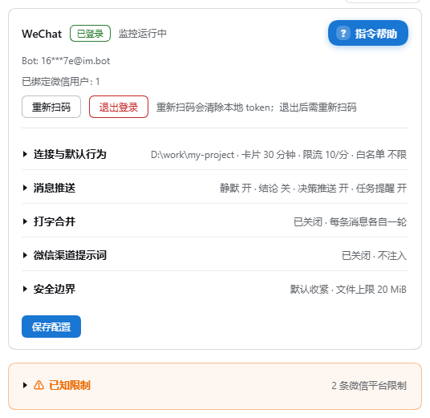
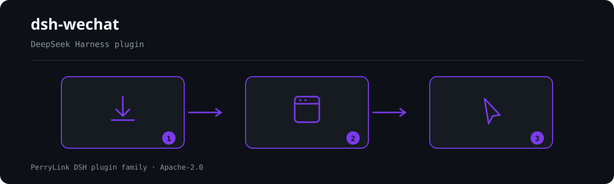

# dsh-wechat

[](https://www.npmjs.com/package/dsh-wechat)
[](https://www.npmjs.com/package/dsh-wechat)
[](https://github.com/pan17/dsh-wechat)

把微信变成 [DeepSeek Harness](https://github.com/deepseek-ai/deepseek-harness) (DSH) 的第二客户端：在微信里和你的 agent 聊天，收发文字、图片、文件和语音，用 slash 命令管理会话、工作区、模型与权限，审批卡和提问卡在微信与桌面端同步弹出。

  



微信与 DSH 双向同步：文字、图片、文件、语音直接发给 agent，回复与执行过程推回微信，审批卡和提问卡两端同弹、谁先答谁生效；`/at` 可引用其它会话或文件，把几条消息或「截图 + 问题」合成一轮，静默模式与结论模式控制推送频率；会话、工作区、Preset、模型、权限都能在微信里用 slash 命令管理，与 GUI 同源；另有秘密脱敏、文件范围限制、入站白名单与审计日志等边界，以及内嵌在 DSH 设置里的扫码登录、配置页与**指令帮助**（每条指令一句说明，点开看全部例子、点一下复制）。

## 安装

要求 DSH `>=0.2.1-0 <0.3.0-0`。

> **本仓库是 PerryLink 的 fork，不发布 npm 包。** npm 上的 `dsh-wechat` 由上游
> [pan17/dsh-wechat](https://github.com/pan17/dsh-wechat) 发布；下面的安装命令装的是上游包。
> 本 fork 用于向上游提交 PR 和本地验证，不提供独立的 npm 版本。

**方式一：设置页**（推荐）— 打开 **设置 → 插件 → 添加插件**，填 `dsh-wechat`，点安装，然后重启 DSH。国内网络慢时把安装源切到**中国大陆镜像源**。

**方式二：命令行**（桌面版）

```bash
dsh plugin --profile desktop add dsh-wechat
dsh plugin --profile desktop list --depth 0    # 查看已装版本
```

安装后打开 **设置 → WeChat** 扫码登录（也可直接访问 `http://127.0.0.1:3080/wechat/qr`）。

## 功能

- **发送** — 微信文本/图片/文件/语音消息 → DSH agent（媒体自动下载解密到
  `~/.dsh-wechat/tempfile/`，本地路径作为附件注入）
- **打字合并（默认开启，⚠️ 改变了旧行为）** — 连续几条微信消息在静默窗口（默认 3 秒）内到达时**合并成一轮**，不再一句话分五段就烧掉五轮；条数上限（默认 10）或上限时间（默认 3 分钟，到点必发）会强制释放。消息末尾 `..` = 还要接着说（暂不发出），`!!` = 立刻提交（两者开启时会被去掉）。**图片/文件不参与合并**：它们会先把已经输入的文字作为一轮发出去，再自己作为一轮进入 agent，顺序不变。微信端 `/merge on|off|status` 切换，设置页同款开关；`mergeSilenceMs: 0` 或 `/merge off` 恢复「每条消息一轮」
- **接收** — agent 正文独立发送；正文之间的思考与工具调用/结果合并成一条「执行过程」，按桌面端的分组方式阅读。过程在收到下一段正文的第一个有效流式片段时立即推送，正文接收完成后独立发送；提问/审批卡或轮次结束也会发送待发过程；`send_wechat` 工具可主动推送文本/文件到微信
- **微信 slash 命令** — `/workspace`、`/session`、`/preset`、`/model`、
  `/perm`、`/silent`、`/flush`、`/notify`、`/next`、`/status`、`/stop`、`/rq` 等
  由 bridge 直接处理（见下方命令表）
- **审批/提问卡（双端同卡）** — 微信与 GUI 弹一致的原生审批/提问卡，
  谁先回复谁生效（原生防双决）
- **微信渠道提示词（动态注入）** — 微信消息注入可配置提示词；GUI 消息时自动消失。设置页可开关/编辑正文，微信 `/surface on|off` 切换
- **静默模式** — `/silent on` 后每轮只发送最终回复，设置页可切换（全局配置，重新扫码后仍保留）。⚠️ 单位是**轮**：一次需求若被拆成多轮（例如目标自动续跑 8 轮），仍会收到 8 条
- **结论模式（只回最终结论）** — 设置页勾选或微信发 `/final on`，跨轮次的中间过程一律暂存，整条任务彻底停下来后**只发一条最终结论**：自动续跑再多轮也只有一条。默认静默 45 秒后交付，最长 10 分钟必发一次；权限卡、提问卡、报错始终立即推送，不受压制；「执行过程」分组直接丢弃；微信发 `/flush` 可随时立即取回。开启后优先于「静默」。配置键 `finalOnly` / `finalOnlyIdleMs` / `finalOnlyCeilingMs`
- **投递可信度** — 错误与摘录先过秘密脱敏（JWT / `sk-` / `gh*_` / `xox*` / `AKIA` / `Bearer` / 长 hex / 长 base64 → `***`，**绝不作用于正常回复正文**）；跨会话完成卡预览取**尾部** 80 字（结论在最后）；长回复按 `（i/n）` 有序分段，代码围栏与表格原子不可切；出站队列满时**强制发出最旧一条**而不是丢弃；`send_wechat` 每分钟限流；`allowedUsers` 白名单可拒绝陌生联系人驱动 bot
- **权限提权只能在本机做** — 微信里的 `/perm default <预设>` 只在**不放宽**权限时写入全局默认；`danger-full-access` 沙箱、或审批策略为 `never` 的预设会被拒绝，并提示到 DSH 设置页操作（全局默认对**所有**新会话生效，与微信无关）。会话级 `/perm switch` 不受影响（非持久）。确需远程改默认时开启 `allowRemotePermissionEscalation`
- **`send_wechat` 不是任意文件读取原语** — 只允许发送**调用会话**工作目录或已注册工作区内的文件（按 `fs.realpath` 归一后比较，`..` 与符号链接都逃不出去），并有字节上限（默认 20 MiB，读取前即拒绝）。要放开任意路径需显式开启 `allowAnyFilePath`
- **入站白名单升级播种** — 老部署升级时若 `state.json` 里**已有绑定用户**且白名单从未配置过，会自动把该用户写入 `allowedUsers`（否则升级后第一个发消息的陌生人就会接管 bot），并在微信里**提示一次**、`/status` 里显示你自己的 user id；全新安装（还没有绑定用户）保持「首个给你发消息的人成为绑定对端」，不会被锁在门外
- **日志与审计** — 入站日志只记**脱敏**后的发送者 id，正文预览再过一次 `maskSecrets`；`~/.dsh-wechat/audit.jsonl` 追加记录入站（脱敏 id + 长度，不含正文）、slash 命令名、审批/提问决定、`send_wechat` 文件路径、每次出站发送结果，按 1 MiB 上限轮转为 `audit.jsonl.1`；`~/.dsh-wechat` 目录 `0700`、其下文件（token/state/config/sync-buf/审计）均为 `0600`
- **出站串行槽可诊断** — 锁内再调用公共入口会**立刻报错**（而不是把自己排到自己后面永久卡死），单次操作挂死时后续发送最多等 30 秒后照常发出并记日志
- **繁忙时投递（与 DSH 同源）** — 按 `busyEnter` 排队/插话；微信 `/enter` 同步
- **跨会话决策推送** — `/notify on` 后，任意会话的权限/提问卡整卡推送到微信。当前会话可直接回；其它会话必须 `P{n}=…`（`P1=/rq` 关闭该卡）。默认关。跨会话任务完成/报错走 `/notify tasks on|off`
- **二维码登录** — `http://127.0.0.1:3080/wechat/qr` 扫码登录，设置页内嵌
- **设置页 UI** — DSH 设置 → **WeChat**：单卡展示状态、扫码、退出登录、连接配置与通知/静默开关（保存即生效，存储于 `~/.dsh-wechat/config.json` 与 `state.json`）
- **断点续传** — `sync-buf` 与微信会话映射持久化，重启 DSH 后自动恢复会话
- **单用户** — 只服务第一个微信用户；bot token 缺失/失效时不向微信推送，日志会写明原因（需重新扫码或等会话恢复）

## 微信命令

| 命令 | 说明 |
|---|---|
| `/help`（`/h`、`/?`） | 命令一览，含当前 profile 已注册的 DSH 原生命令 |
| `/help <命令>` | 该命令的全部例子，如 `/help s`、`/help merge` |
| `/status` | 工作区、会话、模型、上下文、权限、各开关状态 |
| `/workspace`（`/ws`） | `list` / `status` / `switch <编号\|路径>` / `add <路径>` |
| `/session`（`/s`） | `list [current]` / `switch [current]` / `pin` / `unpin` / `new` / `status` |
| `/preset`（`/p`） | `list` / `switch <名称\|编号>` / `status` — 默认 Preset，与 GUI 同步 |
| `/model` | `list` / `switch <提供商/模型>` / `status` |
| `/perm` | `status` / `list` / `switch <名称\|编号>` / `default [名称\|编号]` |
| `/reasoning` | 查看或切换推理等级 |
| `/enter`（`/busy`） | 繁忙时 `queue` 排队还是 `steer` 插话 |
| `/silent`（`/sl`） | 静默模式：每轮只发最终回复 |
| `/final on\|off\|status`（`/fo`） | 结论模式：整条任务只发一条结论 |
| `/merge`（`/mg`） | 打字合并开关与状态 |
| `/media`（`/md`） | 图片/文件合并开关；`at\|path` 切换附件交付措辞 |
| `/at` | 引用其它会话（`s`）或文件/目录（`f`），附加到下一条消息 |
| `/notify`（`/watch`） | 跨会话决策推送；`tasks on\|off` 单独控制任务提醒 |
| `/history` | 查看最近历史，`all` 含系统消息 |
| `/flush`（`/f`） | 立即取回结论模式暂存的结论 |
| `/surface`（`/wxprompt`） | 微信渠道提示词注入开关 |
| `/stop` | 中断当前任务 |
| `/next` | 继续发送被微信限流缓存的消息 |
| `/rq` | 关闭当前会话的待处理卡 |

其它 `/xxx` 作为文本转发给 agent。DSH 原生 slash 命令（`/plan`、`/goal`、`/compact` 等）由 bridge 直接交给原生 handler，微信端无需改动即可识别。

## 开发

```bash
npm install
npm run build    # tsc → dist/
npm test         # vitest
```

改动代码后需**重启 DSH** 才会生效。架构、配置参考、命令接入细节、已知边界与宿主版本兼容见 **[docs/DEVELOPMENT.md](./docs/DEVELOPMENT.md)**。

## 许可

MIT。`src/weixin/`、`src/adapter/` 移植自 [wechat-opencode](https://github.com/pan17/wechat-opencode)（MIT，原始来源 `@tencent-weixin/openclaw-weixin`），文件头保留出处注释。

## 免责声明

本项目与 DeepSeek Harness、腾讯微信官方**互不隶属**，非官方项目，纯属个人学习用途。使用本项目即表示你自行承担由此产生的一切后果。
